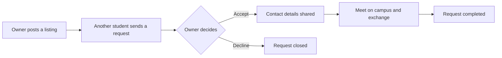

<div align="center">

# 📚 Campus Barter

**Swap, lend or give away books, notes and gear with students on your campus. No cash needed.**


**[Live demo](#live-demo)** · **[Features](#-features)** · **[Getting started](#-getting-started)** · **[Documentation](#-documentation)** · **[Contributing](CONTRIBUTING.md)**

</div>

---

## Live demo

https://campus-barter.onrender.com

> The demo runs on a free plan. It may take about 30 seconds to wake up, and its data can reset when it restarts.

## 💡 Why Campus Barter?

Every semester, students buy expensive books, drafters and lab coats for one year, then leave them in a cupboard. Meanwhile a junior is searching for the very same thing.

Campus Barter connects the two. A senior posts what they no longer need, a junior asks for it, and they meet on campus. Everything is free or swapped.

## ✨ Features

**For students**
- 🔎 **Browse and search** listings, with filters for item type, condition and how it is offered
- 📦 **Item types made for engineering students:** Books, Notes, PYQs book, Mini drafter, Lab coats, Calculator, Other
- 🔁 **Three ways to offer:** Swap, Lend or Give away
- 📷 **Optional photo** on every listing
- 🤝 **Request flow:** send a request, the owner accepts or declines, and either side can cancel
- 🔒 **Privacy first:** contact details stay hidden until a request is accepted
- 🏫 **Campus suggestions:** suggest your own college if it is not listed yet

**For admins**
- 🚩 Review reports on listings, then remove a listing or dismiss the report
- 🛑 Suspend a user
- 🏫 Review campus suggestions

**Built to be safe and maintainable**
- CSRF protection on every form, login and sign-up rate limits, and secure cookies in production
- Security headers and a strict Content Security Policy
- JSON request logs that never contain passwords, tokens or cookies
- A `/health` endpoint for uptime monitors
- 989 automated tests (security, permissions, accessibility, end-to-end stories)

## 🔄 How it works



## 🧰 Tech stack

| Part | Technology |
|---|---|
| Language | Python 3.12 |
| Web framework | Flask 3 with Jinja2 templates |
| Database | SQLite (plain SQL migrations in `migrations/`) |
| Front end | Plain CSS and plain JavaScript, no build step |
| Server | gunicorn |
| Tests | Python `unittest` with the Flask test client |
| CI | GitHub Actions (`.github/workflows/check.yml`) |

## 🚀 Getting started

You need **Python 3.12** ([python.org/downloads](https://www.python.org/downloads/)). On Windows, tick **"Add python.exe to PATH"** during install.

### Windows (Command Prompt)

```bat
git clone https://github.com/YOUR-USERNAME/campus-barter.git
cd campus-barter
py -m venv .venv
.venv\Scripts\activate
pip install -r requirements.txt
flask --app app migrate
flask --app app seed
flask --app app run
```

### macOS / Linux

```bash
git clone https://github.com/YOUR-USERNAME/campus-barter.git
cd campus-barter
python3 -m venv .venv
source .venv/bin/activate
pip install -r requirements.txt
flask --app app migrate
flask --app app seed
flask --app app run
```

Open **http://127.0.0.1:5000** in your browser.

### Demo accounts

`flask --app app seed` creates sample users and listings (development only). It prints a random password once. To choose your own, set `SEED_PASSWORD` before running it.

| Email | Role |
|---|---|
| `asha.fe@college.example` | Student (first year) |
| `ravi.te@college.example` | Student (third year) |
| `meera.be@college.example` | Student (final year) |
| `admin.demo@college.example` | Admin |

### Create a real admin

```bash
flask --app app create-admin
```

It asks for the password, so the password never appears in your command history.

## ⚙️ Configuration

Copy `.env.example` to see every option. In development all of them are optional.

| Variable | What it does |
|---|---|
| `APP_ENV` | `development`, `testing` or `production` |
| `SECRET_KEY` | **Required in production.** At least 32 random characters |
| `DATABASE_PATH` | Where the SQLite file is stored |
| `TRUSTED_PROXIES` | How many reverse proxies sit in front of the app (0 to 5) |
| `LOG_LEVEL` | `DEBUG`, `INFO`, `WARNING`, `ERROR` or `CRITICAL` |
| `SEED_PASSWORD` | Password for the demo users (development only) |

The app refuses to start in production if the secret key is missing or weak.

## 🧪 Running the tests

```bash
pip install -r requirements-dev.txt
python -m unittest discover -s tests
```

The full run takes about 4 to 5 minutes. `bash scripts/check.sh` runs the same checks as the CI.

## ☁️ Deployment

- **Quick demo:** the included `render.yaml` deploys the app to [Render](https://render.com) as a Blueprint.
- **Your own server:** follow the [deploy runbook](docs/runbooks/deploy.md). It covers gunicorn, HTTPS, backups and restore.

## 📁 Project structure

```text
campus-barter/
├── app/                # The application
│   ├── templates/      # Jinja pages (auth, listings, requests, admin, ...)
│   ├── static/         # CSS and JavaScript
│   ├── *_service.py    # Business logic and SQL
│   └── *.py            # Routes, security, config, CLI
├── migrations/         # SQL files that build the database
├── tests/              # 989 automated tests
├── scripts/            # Backup, restore and check scripts
├── docs/               # Architecture, decisions, runbooks, security reviews
├── render.yaml         # One-click deploy to Render
├── start.sh            # Start gunicorn
└── wsgi.py             # Entry point for production servers
```

## 📖 Documentation

| Topic | Where |
|---|---|
| How the code is organised | [docs/ARCHITECTURE.md](docs/ARCHITECTURE.md) |
| System design and database rules | [docs/system-design.md](docs/system-design.md) |
| Why we chose this stack | [docs/decisions/](docs/decisions/) |
| Deploy, backup, rollback, incidents | [docs/runbooks/](docs/runbooks/) |
| Security reviews | [docs/security/](docs/security/) |
| How to add a page, a field or an item type | [docs/how-to/](docs/how-to/) |
| Version history | [CHANGELOG.md](CHANGELOG.md) |

## 🗺️ Roadmap

Ideas for the next versions, taken from the project's own security review:

- [ ] Email verification at sign-up
- [ ] Strip hidden location data (EXIF) from uploaded photos
- [ ] Stop owners editing a listing while a request on it is accepted
- [ ] A "restore removed listing" screen for admins

## 🤝 Contributing

Contributions are welcome. Please read [CONTRIBUTING.md](CONTRIBUTING.md) first, and follow our [Code of Conduct](CODE_OF_CONDUCT.md).

Found a security problem? Please do **not** open a public issue. Read [SECURITY.md](SECURITY.md).

## 📄 License

Released under the [MIT License](LICENSE).
